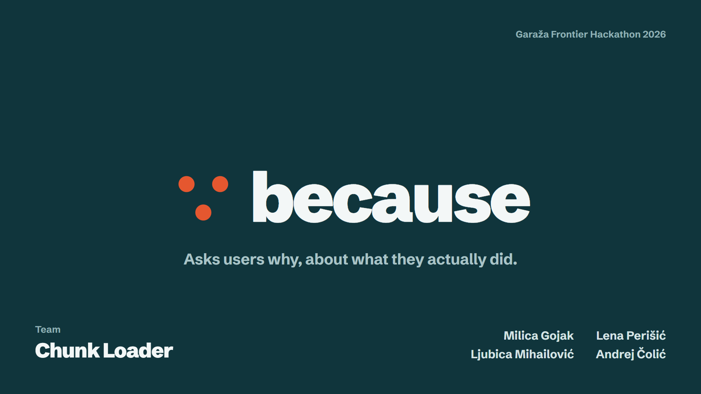
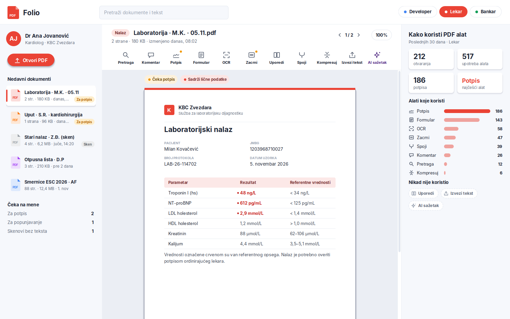
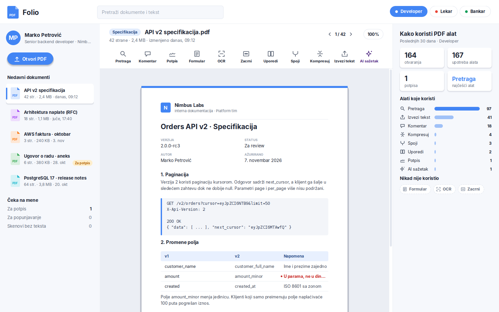
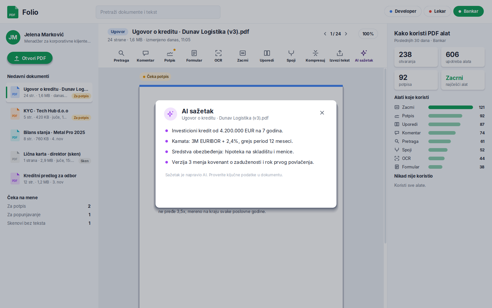

<p align="center"></p>

# ∵ Because

**Analytics tells you *what*. Because tells you *why*.**

Because is an AI user researcher that interviews every one of your users. It connects to PostHog, groups users by how they actually use your product, runs a short AI interview with each of them about what *they* did, and writes the answers back into PostHog.

> Built in one weekend by team **Chunk Loader** at the **Garaža Frontier Hackathon**, November 2026.

---

## The problem

Your last board meeting probably went something like this: the numbers are down, users are leaving, and nobody in the room can say why.

- **84% of product teams can't say why most of their users leave.**
- **80% of features are rarely or never used**, according to Pendo's analysis of more than 600 products.

These teams have data on every single click and still can't explain it. Analytics tells you what users do. It doesn't tell you why.

Today there are two ways to ask, and neither really works:

| | Reach | Depth |
| --- | --- | --- |
| **Surveys** | Everyone | Shallow: everyone gets the same generic question |
| **Interviews** | A handful of people | Deep, but slow and expensive |
| **Because** | Everyone | Deep: every question is about that person's real usage |

And the users you most need to hear from, the ones who quietly gave up, never volunteer.

## How it works

```
Your product ──events──▶ PostHog
PostHog ──HogQL──▶ facts per user (computed by code) ──▶ behavior groups
group + facts ──▶ AI interview (Claude) ──▶ structured result
result ──capture + $set──▶ PostHog (ai_segment, ai_main_reason, ...) ──▶ cohorts
```

1. **Connect to PostHog.** Because reads your existing events. PostHog is already used by more than half a million teams, so there is nothing new to instrument.
2. **Group users by behavior.** Plain code (no model) turns events into facts ("signed 186 documents in the last 30 days", "has never opened the AI summary") and sorts people into groups by how they actually use the product. No demographics, only behavior.
3. **Interview each one.** Claude runs a 2–3 minute chat interview that starts by asking for consent and may only reference facts from that person's profile. No generic questions, only personal ones, grounded in real usage.
4. **Write the answer back.** Each interview becomes an `ai_interview_completed` event plus person properties (`ai_main_reason`, `ai_sentiment`, `ai_suggested_change`, ...), so your team can build cohorts by *reason* in PostHog, without writing code.
5. **Synthesize per group.** For every group, Because clusters the interviews into themes with verbatim quotes. People counts are computed by code and every quote is checked against the transcripts.

Until now you had to choose between depth and scale. An AI agent gets the reach of a survey and the depth of an interview.

## Example

You're the product manager of a PDF tool. Your team spent three months building an AI summary, and one group of users, doctors, never opens it.

**Today, you guess.** Maybe they can't find it? You add a tooltip and hope.

**With Because**, every doctor who never opened it gets asked about it directly:

> *"You sign lab reports and fill in referrals every day, but you have never opened the AI summary of a report. Why?"*

Their answers come back as evidence: the main reason, quotes that prove it and a concrete suggested change. You make a real decision instead of a guess.

## What's in this repo

| Folder | What it is |
| --- | --- |
| [`folio/`](folio/folio/README.md) | **Folio**, a demo PDF tool (Java Swing) with three profiles (developer, doctor, banker) that use the same tool very differently. It sends `feature_used` and `document_opened` events to PostHog and is the data source for the demo. |
| [`insights/`](insights/README.md) | **Because** itself: a Next.js + TypeScript app that reads from PostHog, builds facts and groups, runs the interviews with Claude, writes results back and shows the per-group synthesis. |
| `pitch/` | The pitch slides (HTML) and their exported frames. |
| `PRODUCT.md` | Product and design brief: users, brand, design principles. |

<p align="center">
  
  
  
</p>

## Quick start

**Requirements:** Node.js 20+, Java 17+, a PostHog project, and a Claude API key (Anthropic or Perplexity).

```bash
# 1. The app
cd insights
npm install
cp .env.example .env.local     # add PostHog and Claude keys

npm run seed                   # ~200 synthetic users, ~100k events -> PostHog
npm run fetch                  # pull events from PostHog into a local cache
npm run simulate -- --per 8    # optional: simulated interviews (clearly labeled as simulated)
npm run synthesize             # reason synthesis per group
npm run dev                    # http://localhost:3000

# 2. A live user
cd ../folio/folio
POSTHOG_KEY=phc_... java -jar folio.jar --profile doctor --user "Your Name"
```

Use Folio for a minute, hit **Refresh from PostHog** on the home page, and you will show up in a group, ready to be interviewed about what you just did.

No PostHog keys? The app also runs on the local seed backup. See [`insights/README.md`](insights/README.md) for every script, environment variable and the grouping rules.

## Design principles

- **Code computes the facts, AI asks the questions.** The only thing the model decides is how to run the interview. Every fact, group and people count comes from code.
- **The user's voice comes first.** Quotes are the evidence, shown verbatim.
- **Honest about simulation.** Simulated interviews are always labeled; real ones stand out.
- **Consent first.** Every interview opens by asking whether the person wants to take part.

## Built with

Next.js · TypeScript · Claude (Anthropic SDK) · PostHog (HogQL query API + capture) · Java Swing · zod

## Team: Chunk Loader

Milica Gojak · Lena Perišić · Ljubica Mihailović · Andrej Čolić

## What's next

- **Gets smarter with every interview.** Predict how users will react to a new feature before it's built, then confirm it with just a handful of interviews. Teams stop spending months on features nobody uses.
- **From chat to voice.** As AI voice keeps improving, interviews move from chat to real voice conversations.

---

<p align="center"><b>Analytics tells you what. Because tells you why.</b></p>
